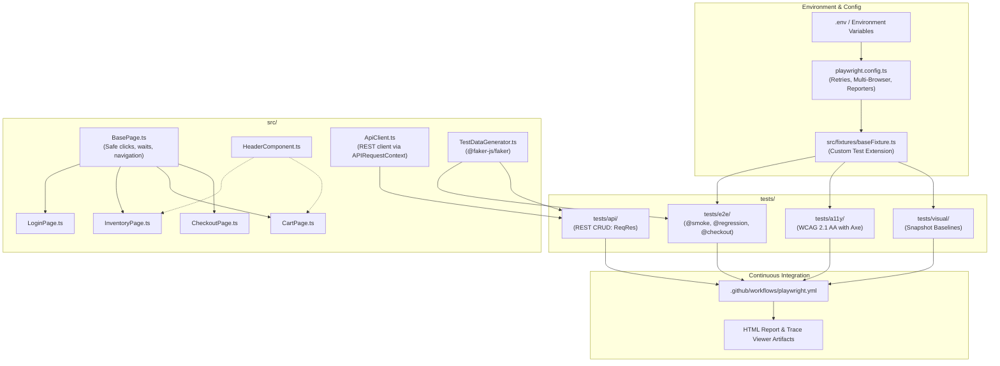

# 🎭 Playwright + TypeScript Enterprise Test Automation Framework

[](https://github.com/YOUR_GITHUB_USERNAME/playwright-typescript-portfolio/actions)


A production-grade, enterprise test automation framework built with **Playwright** and **TypeScript**. Designed as an industry-standard SDET portfolio demonstrating clean architecture, design patterns, automated accessibility audits, visual regression, API testing, and automated CI/CD pipeline execution.

---

## 🌟 Architectural Highlights

- **📐 Page Object Model (POM) + Component Architecture**: Decouples UI locators and page actions from test assertions. Modular component objects (`HeaderComponent`) prevent locator duplication across views.
- **💉 Custom Dependency Injection Fixtures (`test.extend`)**: Page objects and utilities are cleanly injected directly into test parameter signatures, eliminating boiler-plate instantiation in every test.
- **⚡ Pre-Authenticated Session Fixtures**: Demonstrates how to bypass redundant UI login steps across large test suites using smart fixture hooks.
- **🌐 Hybrid E2E & REST API Testing**: Complete API testing suite utilizing Playwright's `APIRequestContext` for CRUD operations, status code validation, and schema assertions.
- **🛡️ Network Interception & Mocking (`page.route`)**: Validates front-end resilience against simulated API delays, server 500 errors, and image asset blocking.
- **♿ Automated Accessibility (a11y) Audits**: Integrated `@axe-core/playwright` scanning pages for WCAG 2.1 Level AA accessibility violations.
- **👁️ Visual Regression Testing**: Pixel-by-pixel snapshot comparison (`toHaveScreenshot`) with configurable tolerance thresholds and animations disabled.
- **🎲 Dynamic Test Data Management**: Generates realistic, non-colliding test payloads (customer names, emails, postal codes) using `@faker-js/faker`.
- **🚀 CI/CD Pipeline Ready**: GitHub Actions workflow featuring automated dependency caching, cross-browser matrix runs, trace collection, and HTML report artifact publishing.

---

## 🏗️ Architecture & Component Flow



---

## 📁 Repository Structure

```text
├── .github/
│   └── workflows/
│       └── playwright.yml             # GitHub Actions CI/CD configuration
├── src/
│   ├── api/
│   │   ├── ApiClient.ts              # Playwright request-based REST client
│   │   └── Endpoints.ts              # Centralized API endpoints dictionary
│   ├── components/
│   │   └── HeaderComponent.ts        # Modular header navigation & cart badge component
│   ├── fixtures/
│   │   └── baseFixture.ts            # Custom test fixture (POM injection, a11y, auth)
│   ├── pages/
│   │   ├── BasePage.ts               # Core wrapper class for shared page mechanics
│   │   ├── LoginPage.ts              # Authentication page object
│   │   ├── InventoryPage.ts          # Catalog browsing, sorting, and item selection
│   │   ├── CartPage.ts               # Cart review and item deletion
│   │   └── CheckoutPage.ts           # Customer shipping info and payment calculation
│   └── utils/
│       ├── envConfig.ts              # Typed environment configuration loader
│       └── testDataGenerator.ts      # Faker-powered dynamic payload generator
├── tests/
│   ├── a11y/
│   │   └── accessibility.spec.ts     # WCAG 2.1 AA compliance audit
│   ├── api/
│   │   └── users-api.spec.ts         # REST API test suite (GET, POST, PUT, DELETE)
│   ├── e2e/
│   │   ├── auth.spec.ts              # Login happy path, locked user, error validations
│   │   ├── checkout.spec.ts          # Full purchasing flow & pricing calculations
│   │   └── network-mock.spec.ts      # Route interception & network resilience
│   └── visual/
│       └── visual-regression.spec.ts # Snapshot comparison tests
├── .env.example                      # Template for environment variables
├── package.json                      # Dependencies and test runner scripts
├── playwright.config.ts              # Master Playwright configuration
├── tsconfig.json                     # TypeScript strict configuration & path aliases
└── README.md
```

---

## 🚀 Quick Start Guide

### 1. Prerequisites
- **Node.js** v18+ installed
- **npm** v9+ installed

### 2. Installation
```bash
# Clone the repository
git clone https://github.com/YOUR_GITHUB_USERNAME/playwright-typescript-portfolio.git
cd playwright-typescript-portfolio

# Install dependencies
npm install

# Install Playwright browser binaries
npx playwright install --with-deps
```

### 3. Environment Configuration
Copy `.env.example` to `.env`:
```bash
cp .env.example .env
```
Default values point to the live [Sauce Demo](https://www.saucedemo.com) and [ReqRes](https://reqres.in) demo services.

---

## 🧪 Test Execution Scripts

| Script | Command | Description |
| :--- | :--- | :--- |
| **All Tests** | `npm test` | Runs the full test suite across all configured browsers |
| **Chromium Only** | `npm run test:chromium` | Quick test execution on Desktop Chromium |
| **Headed Mode** | `npm run test:headed` | Opens a live browser window during test execution |
| **Interactive UI** | `npm run test:ui` | Launches Playwright's time-travel UI Mode debugger |
| **Smoke Suite** | `npm run test:smoke` | Runs critical path authentication & navigation tests |
| **Regression Suite** | `npm run test:regression` | Runs complete end-to-end purchasing flows |
| **API Suite** | `npm run test:api` | Runs standalone REST API tests |
| **Accessibility** | `npm run test:a11y` | Runs WCAG 2.1 AA automated scans |
| **Visual Regression**| `npm run test:visual` | Runs visual snapshot assertions |
| **Debug Mode** | `npm run test:debug` | Opens the Playwright Inspector for step-by-step debugging |
| **View HTML Report**| `npm run report` | Serves the interactive HTML test report |
| **Codegen** | `npm run codegen` | Launches Playwright code generator against the target app |

---

## 📊 Test Reporting & Artifacts

Playwright automatically generates detailed test execution artifacts upon test failures:
- **Trace Viewer**: Inspect DOM snapshots, console logs, network waterfalls, and action timings for every step.
- **Failure Screenshots & Videos**: Captured automatically only when a test fails (`only-on-failure`), conserving disk space and CI execution time.
- **HTML Report**: Interactive test report grouped by browser, tag, and suite.

```bash
# View the latest generated report
npm run report
```

---

## 🔄 CI/CD Pipeline (GitHub Actions)

This repository includes a production-ready GitHub Actions workflow (`.github/workflows/playwright.yml`):
- Runs automatically on **Pull Requests** and pushes to `main`.
- Caches Playwright browser binaries between builds to optimize CI run times.
- Executes tests in parallel across headless container environments.
- Uploads the interactive HTML report as a build artifact retained for 14 days.

---

## 💼 CV / Interview Talking Points

When presenting this project to recruiters, hiring managers, or in technical interviews, highlight:
1. **Design Philosophy**: *"I built this framework using Page Object Model and Custom Fixtures to ensure high maintainability, avoid test flakiness, and eliminate repetitive setup code."*
2. **Beyond Standard E2E**: *"In addition to UI testing, I incorporated API contract validation, network route mocking, WCAG accessibility scans with Axe, and visual regression testing."*
3. **CI/CD Integration**: *"The framework runs on GitHub Actions with caching strategies and artifact uploads, ensuring continuous automated feedback on every pull request."*
4. **Resilience**: *"I relied strictly on user-facing semantic locators (`getByRole`, `data-test`) and Playwright's auto-waiting assertions rather than arbitrary sleep timeouts."*

---

## 📄 License
This project is open-source and licensed under the [MIT License](LICENSE).
